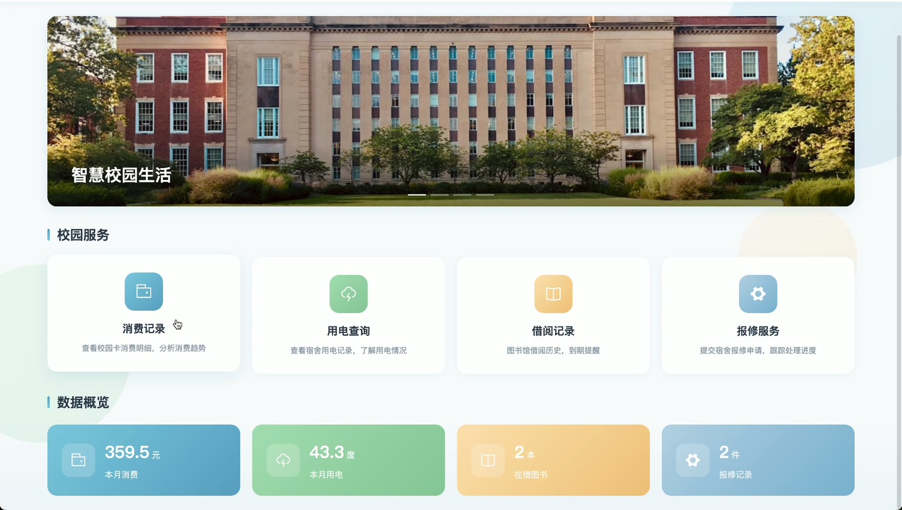
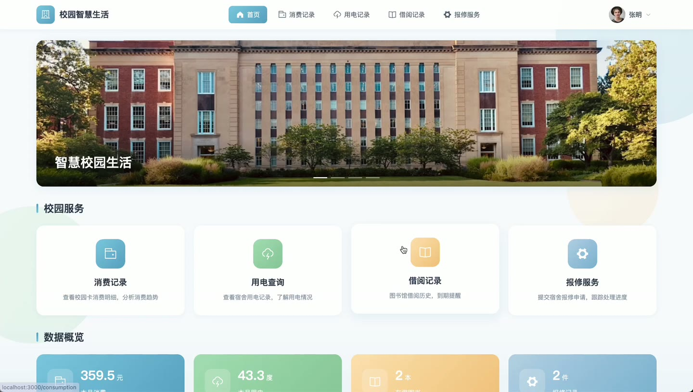
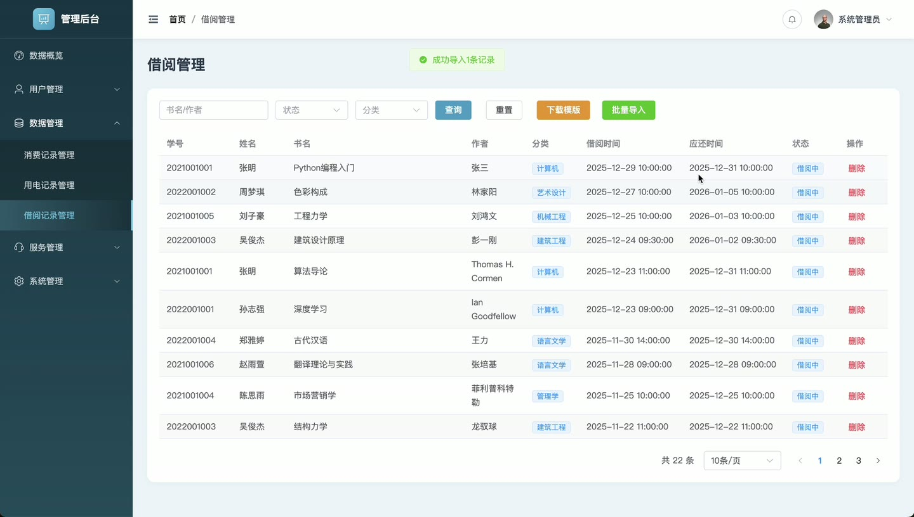
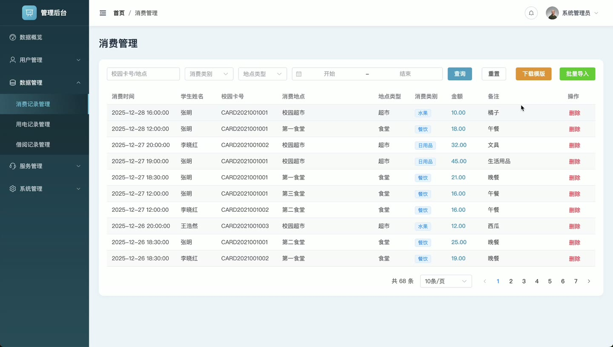
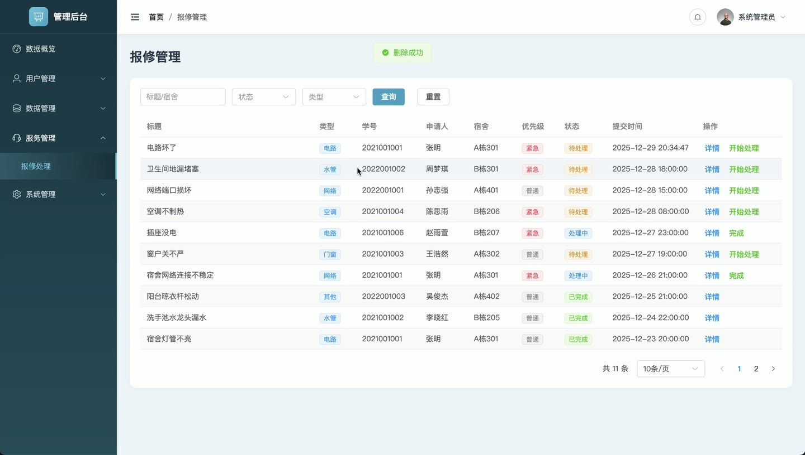
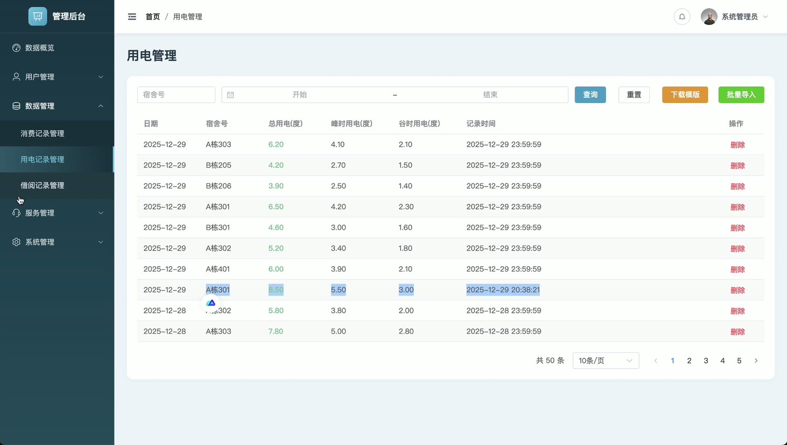

# (附文档)Python+Flask+Vue3 校园智慧生活数据分析平台

**技术栈**：Python、Flask、Vue3、MySQL

### 系统简介

校园智慧生活数据分析平台是一套前后端分离的校园生活数据管理系统，后端基于 Python Flask 提供 RESTful 接口，前端使用 Vue3 + Element Plus 构建。系统面向学生与管理员两类角色，覆盖校园卡消费、宿舍用电、图书借阅、宿舍报修、数据预警与轮播图运营等业务场景，并通过可视化图表对校园生活数据进行统计分析。
 
### 核心功能
 
### 学生端

 
- 学生注册：填写学号、姓名、密码等信息完成账号注册。 
- 学生登录：使用学号与密码登录，登录后写入 token 与用户信息。 
- 首页展示：查看轮播图与平台入口，快速进入各业务页面。 
- 消费记录查询：按消费类别、地点类型、日期区间筛选本人的校园卡消费明细。 
- 用电记录查询：按宿舍号与日期区间查看本人宿舍的用电量、峰时用电与谷时用电。 
- 借阅记录查询：查看本人借阅明细，支持按借阅中、已归还、已逾期状态筛选。 
- 借阅统计：查看总借阅、在借中、已归还、已逾期数量及借阅分类占比图表。 
- 报修提交：填写报修类型、标题、描述、宿舍与优先级，提交宿舍报修申请。 
- 报修进度查看：查看本人提交的报修单状态与处理备注。 
- 个人中心：维护手机号、邮箱、头像等个人资料，并修改登录密码。
 
### 管理员端

 
- 管理员登录：使用管理员账号登录后台，路由校验角色为管理员方可进入。 
- 数据概览：查看学生总数、今日消费、待处理报修、在借图书四项核心指标。 
- 消费趋势分析：按近7天或近30天查看消费金额折线趋势。 
- 消费分类占比：查看各消费类别金额占比饼图。 
- 用电峰谷统计：查看每日峰时与谷时用电量堆叠柱状图。 
- 报修类型分布：查看各报修类型的数量占比饼图。 
- 宿舍用电排行：查看各宿舍用电量排行柱状图。 
- 图书借阅分类：查看各图书分类借阅数量占比饼图。 
- 用户管理：按学号、姓名、角色、状态查询用户，新增、编辑、删除用户，重置密码为123456，启用或禁用账号。 
- 消费管理：按校园卡号、地点、消费类别、地点类型、日期区间查询消费记录，支持批量导入与下载模版，可删除记录。 
- 用电管理：按宿舍号与日期区间查询用电记录，支持批量导入与下载模版，可删除记录。 
- 借阅管理：按书名、作者、状态、分类查询借阅记录，支持批量导入与下载模版，可删除记录。 
- 报修管理：按标题、宿舍、状态、类型查询报修单，查看详情，执行开始处理与完成处理并填写处理备注。 
- 预警设置：按预警类型查询预警配置，新增、编辑、删除用电预警与消费预警，设置最小阈值、最大阈值与启用状态。 
- 轮播图管理：新增、编辑、删除轮播图，上传图片、设置跳转链接、排序与启用状态。 
- 数据备份：创建备份并填写备注，下载、恢复、删除备份记录，展示文件名、大小、操作人与备份时间。 
- 个人信息：维护管理员手机号、邮箱、头像，并修改登录密码。
 
### 技术栈

 后端语言Python 后端框架Flask ORMFlask-SQLAlchemy 数据库MySQL 前端框架Vue3 UI 组件库Element Plus 状态管理Pinia 前端路由Vue Router 图表库ECharts 构建工具Vite 鉴权方式Token 鉴权
 
### 交付内容

 
- 后端完整源码 
- 前端完整源码 
- 数据库初始化脚本 
- 万字文档

## 界面展示

---

## 获取完整源码 + 万字文档

本仓库为项目介绍页。**完整前后端源码、数据库初始化脚本、万字项目文档**，请加微信 `kangkangcode`，或访问 [codekk.top](http://codekk.top) 获取。

可作课程设计 / 毕业设计参考，支持远程部署调试。